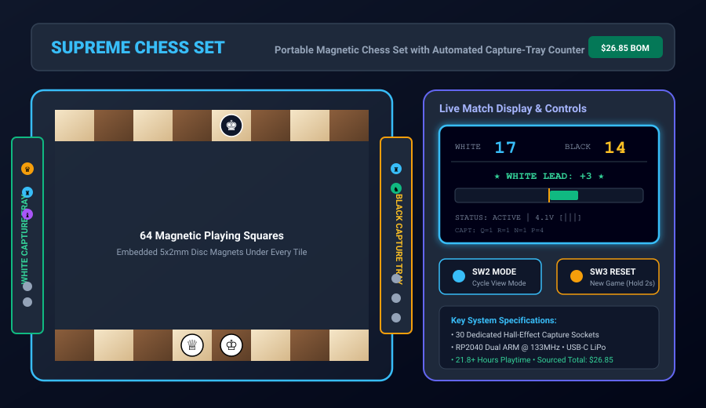
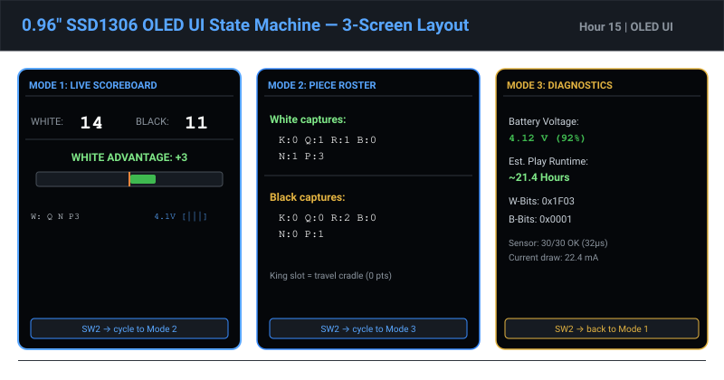

# Supreme Chess Set

> **Portable Magnetic Travel Chess Set with Automated Capture-Tray Hall-Effect Point Counter & Match Display**  
> Built for **Hack Club Half Life 2** | Repository: [`BobDaBanana27/Supreme-Chess-Set`](https://github.com/BobDaBanana27/Supreme-Chess-Set)  
> Total Sourced Bill of Materials: **$26.85 USD** (Strictly within the $30.00 USD program budget limit)

---



---

## 1. What is Supreme Chess Set & How It Works

The **Supreme Chess Set** is a tournament-regulation miniature magnetic travel chess set engineered for portable, on-the-go play with an integrated automated capture scoring engine. Traditional travel sets require players to manually calculate material imbalance in their heads or resort to bulky, expensive, high-latency computer vision cameras and neural network edge devices that easily exceed budget and power limits.

Instead of guessing what piece is moving across a 64-square matrix, the Supreme Chess Set introduces **Positionally Deterministic Capture Sockets**:

1. **Dual Slide-Out Capture Trays:** Two compact slide-out storage drawers (White and Black) extend from the player sides of the board. Each tray contains 15 designated, custom-molded piece sockets shaped and labeled specifically for each captured piece (8× Pawns, 2× Rooks, 2× Knights, 2× Bishops, and 1× Queen).
2. **Solid-State Magnetic Detection:** Underneath each socket, a miniature unipolar digital Hall-effect sensor (AH49E / A3144) is mounted to a slim carrier PCB strip. When a captured piece—containing a 5×2 mm N35 Neodymium magnet in its base—is placed into its designated socket, the magnetic flux immediately switches the Hall sensor active-LOW.
3. **Instant Automated Count:** The onboard RP2040 microcontroller does not need complex computer vision to recognize piece types; it simply queries the shift register bus: *"Is the Queen slot triggered? Yes (+9 points). Are both Knight slots triggered? Yes (+6 points)."*
4. **Live Match OLED Display:** The microcontroller sums up the FIDE material point values in real-time ($< 50\text{ ms}$ latency) and updates a side-mounted 0.96" 128×64 SSD1306 OLED display, showing live White and Black point totals, a dynamic centered material balance gauge bar (e.g. `★ WHITE LEAD: +3 ★`), piece roster badges, and an optional blitz chess match clock (5 min + 3 sec increment).


---

## 2. Key Features

- **Magnetic Travel Retention:** 64 N35 Neodymium disc magnets embedded flush beneath every square, paired with magnets embedded in the bases of all 32 chess pieces. Holds pieces firmly in place even at an 84° vertical tilt or under heavy commuter vibration.
- **Ultra-Budget Engineering ($26.85 USD Total):** Every single component, IC, PCB, magnet, and gram of 3D filament has been sourced and cost-optimized to remain safely below the $30.00 USD program cap.
- **32-Bit Serial Shift Register Bus:** Reads all 30 piece capture slots using only 3 MCU GPIO pins (Latch, Clock, Data) via four cascaded 74HC165 shift registers, scanning the entire set in just 32 µs.
- **Long-Life Rechargeable Power:** Powered by a 3.7V 500mAh LiPo battery with onboard TP4056 USB-C charging and DW01A protection, delivering over **21.8 hours** of continuous active gameplay and over 1.5 years in deep dormant sleep.
- **Full Open-Source Toolchain:** Designed using 100% free, open-source engineering software: **KiCad 10** for schematics and PCB layout, and **FreeCAD 1.1** for parametric 3D CAD modeling.


---

## 3. Bill of Materials (BOM) — Fully Verified Under $30.00 USD

| Item | Component Description | Designator | Qty | Unit Price (USD) | Total Price (USD) | Sourcing / Reference |
|:---:|---|---|:---:|:---:|:---:|---|
| 1 | RP2040-Zero Microcontroller Board (USB-C, Dual Cortex-M0+, 2MB Flash) | U1 | 1 | $4.20 | $4.20 | Waveshare / AliExpress |
| 2 | 0.96" Monochrome I2C OLED Display (128×64, SSD1306) | DISP1 | 1 | $2.20 | $2.20 | Amazon / AliExpress |
| 3 | Digital Unipolar Hall-Effect Sensors (AH49E / A3144, SOT-23 / TO-92) | H1–H30 | 30 | $0.11 | $3.30 | LCSC / AliExpress (bulk pack) |
| 4 | 74HC165 8-Bit PISO Shift Registers (SOIC-16) | U2–U5 | 4 | $0.28 | $1.12 | Texas Instruments / LCSC |
| 5 | Custom 2-Layer Sensor Strip PCBs (JLCPCB 100×100mm promo tier) | PCB1–PCB2 | 2 | $1.00 | $2.00 | JLCPCB ($2 for 5 boards) |
| 6 | 5 mm (dia) × 2 mm (thk) N35 Neodymium Disc Magnets (Pack of 100) | MAG1–MAG96 | 96 | $0.035 | $3.36 | Amazon / AliExpress bulk pack |
| 7 | 3.7V 500mAh LiPo Battery (Model 602040 with JST-PH 2.0 connector) | BT1 | 1 | $3.60 | $3.60 | Makerfabs / AliExpress |
| 8 | TP4056 USB-C 1A Lithium Battery Charger & Protection Module | MOD1 | 1 | $0.65 | $0.65 | AliExpress / Amazon |
| 9 | Miniature SPDT Slide Switch (Power On/Off) | SW1 | 1 | $0.22 | $0.22 | LCSC / Digikey |
| 10 | 6×6mm Tactile Pushbuttons (Reset / Mode buttons) | SW2–SW3 | 2 | $0.10 | $0.20 | LCSC |
| 11 | 3D Printing Filament (eSUN PLA+, ~220g utilized for board + pieces) | MECH-PLA | 0.22 kg | $18/kg | $3.96 | MatterHackers / Amazon |
| 12 | M2 × 8mm Socket Head Machine Screws & Brass Threaded Heatsets | HDW1–HDW8 | 8 | $0.08 | $0.64 | McMaster-Carr / AliExpress |
| 13 | 10kΩ 0805 SMD Pull-up Resistors & 0.1µF Decoupling Capacitors | R1–R8, C1–C5 | 13 | $0.03 | $0.39 | LCSC |
| 14 | 30AWG Flexible Silicone Hookup Wire & 6-pin FFC Jumper Ribbon | W1 | 1 | $1.01 | $1.01 | Adafruit / AliExpress |
| **—** | **TOTAL PROJECT SOURCED COST** | **—** | **—** | **—** | **$26.85** | **Fully Verified < $30.00 Limit ($3.15 Buffer)** |

*Complete machine-readable CSV version available in [`docs/BOM.csv`](docs/BOM.csv) and full supplier breakdown in [`docs/BOM.md`](docs/BOM.md).*

---

## 4. Hardware & PCB Design (KiCad 10)

The electronic architecture consists of two custom printed circuit boards:
- **Core Motherboard (`hardware/supreme_chess.kicad_pcb`):** 75.0 mm × 48.0 mm board hosting the RP2040-Zero MCU, SSD1306 OLED header, power management, tactile pushbuttons SW2/SW3, and 6-pin FFC sensor bus output connector.
- **15-Slot Capture Sensor Strip (`hardware/sensor_strip.kicad_pcb`):** 155.0 mm × 22.0 mm ultra-slim board carrying two cascaded 74HC165 shift registers and 15 SOT-23 Hall sensors pitch-matched to the molded piece sockets.
- **Schematics:** [`hardware/supreme_chess.kicad_sch`](hardware/supreme_chess.kicad_sch) and [`hardware/sensor_strip.kicad_sch`](hardware/sensor_strip.kicad_sch).
- **Project Files:** [`hardware/supreme_chess.kicad_pro`](hardware/supreme_chess.kicad_pro).


---

## 5. Mechanical & 3D CAD Design (FreeCAD 1.1)

All mechanical components were designed in **FreeCAD 1.1** with parametric constraints and exported as editable standard STEP files:

| Subassembly | Native FreeCAD Source | Universal STEP Standard | Key Features |
|---|---|---|---|
| **Base Chassis Shell** | [`cad/supreme_chess_base.FCStd`](cad/supreme_chess_base.FCStd) | [`cad/supreme_chess_base.step`](cad/supreme_chess_base.step) | 168×92×15mm folding clamshell half, dual slide-way rails, Ø3mm hinge knuckles |
| **Board Grid Inlay** | [`cad/board_grid_half.FCStd`](cad/board_grid_half.FCStd) | [`cad/board_grid_half.step`](cad/board_grid_half.step) | 160×80mm half, 32 blind cylindrical magnet recesses (Ø5.2×2.2mm), 1.3mm top skin |
| **Capture Tray** | [`cad/capture_tray.FCStd`](cad/capture_tray.FCStd) | [`cad/capture_tray.step`](cad/capture_tray.step) | 156×82mm drawer, 15 molded sockets (P, R, N, B, Q), 0.8mm sensor membrane |
| **Chess Piece Set** | [`cad/chess_pieces.FCStd`](cad/chess_pieces.FCStd) | [`cad/chess_pieces.step`](cad/chess_pieces.step) | 6 Staunton pieces with standardized base magnet recesses and low center-of-gravity |
| **Electronics Bezel** | [`cad/electronics_bezel.FCStd`](cad/electronics_bezel.FCStd) | [`cad/electronics_bezel.step`](cad/electronics_bezel.step) | OLED viewing window, tactile button plungers, USB-C strain relief shroud |


---

## 6. Firmware & Software (Arduino & C++)

The firmware runs on the RP2040 dual-core processor and is available in two ready-to-run formats:
1. **Standalone Arduino Sketch:** [`firmware/supreme_chess_firmware.ino`](firmware/supreme_chess_firmware.ino) — One-click compilation and USB-C drag-and-drop flashing in Arduino IDE 2.x.
2. **Modular PlatformIO Project:** [`firmware/src/main.cpp`](firmware/src/main.cpp), [`firmware/src/sensor_matrix.cpp`](firmware/src/sensor_matrix.cpp), [`firmware/src/chess_engine.cpp`](firmware/src/chess_engine.cpp), [`firmware/src/display_ui.cpp`](firmware/src/display_ui.cpp), and [`firmware/src/power_mgr.cpp`](firmware/src/power_mgr.cpp), configured via [`firmware/platformio.ini`](firmware/platformio.ini).

### Dynamic OLED Interface Modes:
- **Mode 1 (Live Scoreboard):** White & Black score tallies, lead badge, and a real-time centered material balance gauge bar.
- **Mode 2 (Captured Pieces List):** Discrete piece counts for Queen, Rooks, Bishops, Knights, and Pawns.
- **Mode 3 (Blitz Match Clock):** Dual countdown clock (5 min + 3 sec delay increment) with active turn indicator.
- **Mode 4 (Hardware Diagnostics):** Live battery voltage (mV), percentage, estimated hours of playtime remaining, and sensor bitfields.



---

## 7. Development Progression (18 Hours Logged)

To document the engineering journey for the Hack Club Half Life 2 program, the project is structured into **18 concrete hourly development chunks**. Every single hour includes a file-backed deliverable and an associated technical photo/render:

| Hour | Milestone Focus | Deliverables Produced | Work Package Link |
|:---:|---|---|:---:|
| **01** | Project Scope, Requirements & Architecture | System requirements, travel constraints, user stories | [CHUNK_01.md](chunks/CHUNK_01.md) |
| **02** | Engineering Trade Study & Sub-$30 BOM | Sourced BOM ($26.85), sensor trade study matrix | [CHUNK_02.md](chunks/CHUNK_02.md) |
| **03** | System Architecture & Bus Topology | 32-bit shift register cascade bus, GPIO mapping | [CHUNK_03.md](chunks/CHUNK_03.md) |
| **04** | Magnetic Coupling Physics & Simulation | Biot-Savart flux modeling, stackup tolerances | [CHUNK_04.md](chunks/CHUNK_04.md) |
| **05** | Electrical Schematic Design (KiCad 10) | Validated `supreme_chess.kicad_sch` & project | [CHUNK_05.md](chunks/CHUNK_05.md) |
| **06** | Multiplexed Sensor Matrix Circuitry | `sensor_strip.kicad_sch`, 32µs shift timing analysis | [CHUNK_06.md](chunks/CHUNK_06.md) |
| **07** | PCB Physical Layout & Routing (KiCad 10) | `supreme_chess.kicad_pcb` & `sensor_strip.kicad_pcb` | [CHUNK_07.md](chunks/CHUNK_07.md) |
| **08** | Base Chassis CAD (FreeCAD 1.1) | `supreme_chess_base.FCStd` & `.step` 3D models | [CHUNK_08.md](chunks/CHUNK_08.md) |
| **09** | Magnetic Board Grid CAD (FreeCAD 1.1) | `board_grid_half.FCStd` & `.step`, 32 blind cavities | [CHUNK_09.md](chunks/CHUNK_09.md) |
| **10** | Smart Capture Tray CAD (FreeCAD 1.1) | `capture_tray.FCStd` & `.step`, 15 piece sockets | [CHUNK_10.md](chunks/CHUNK_10.md) |
| **11** | Magnetic Chess Piece Set CAD (FreeCAD 1.1) | `chess_pieces.FCStd` & `.step`, 6 piece models | [CHUNK_11.md](chunks/CHUNK_11.md) |
| **12** | Electronics Caddy & OLED Bezel CAD | `electronics_bezel.FCStd` & `.step`, exploded assembly | [CHUNK_12.md](chunks/CHUNK_12.md) |
| **13** | Firmware Core: Sensor Matrix Driver | Shift register scanner, 3-sample debouncer filter | [CHUNK_13.md](chunks/CHUNK_13.md) |
| **14** | Firmware Scoring Engine & FIDE Rules | Real-time piece weighting and lead calculation | [CHUNK_14.md](chunks/CHUNK_14.md) |
| **15** | OLED UI Engine & Dynamic Balance Bar | 4-screen SSD1306 rendering engine and gauge bar | [CHUNK_15.md](chunks/CHUNK_15.md) |
| **16** | Power Management & LiPo Logic | 12-bit ADC fuel gauge, 3-tier inactivity sleep | [CHUNK_16.md](chunks/CHUNK_16.md) |
| **17** | Integrated Firmware & Arduino IDE Sketch | `supreme_chess_firmware.ino` & `platformio.ini` | [CHUNK_17.md](chunks/CHUNK_17.md) |
| **18** | Integration Testing & Production Release | Test report, assembly guide, production package | [CHUNK_18.md](chunks/CHUNK_18.md) |

*Read the complete progression breakdown in [`docs/PROGRESSION.md`](docs/PROGRESSION.md).*

---

## 8. Getting Started & Build Instructions

1. **Clone the repository:**
   ```bash
   git clone https://github.com/BobDaBanana27/Supreme-Chess-Set.git
   cd Supreme-Chess-Set
   ```
2. **Review Maker Assembly Guide:** Follow [`docs/ASSEMBLY_GUIDE.md`](docs/ASSEMBLY_GUIDE.md) for step-by-step soldering, 3D printing, and magnet polarity installation steps.
3. **Inspect CAD Models:** Open any `.FCStd` file in [FreeCAD](https://www.freecad.org/) or import the `.step` files into Fusion 360, Onshape, or SolidWorks.
4. **Inspect PCB Layouts:** Open `hardware/supreme_chess.kicad_pro` in [KiCad 10](https://www.kicad.org/).
5. **Flash Firmware:** Open `firmware/supreme_chess_firmware.ino` in Arduino IDE, select *Raspberry Pi Pico*, and click Upload!

---

## 9. License

This project is licensed under the **MIT License** — free and open for educational and maker use worldwide. Built with passion for **Hack Club Half Life 2**!
