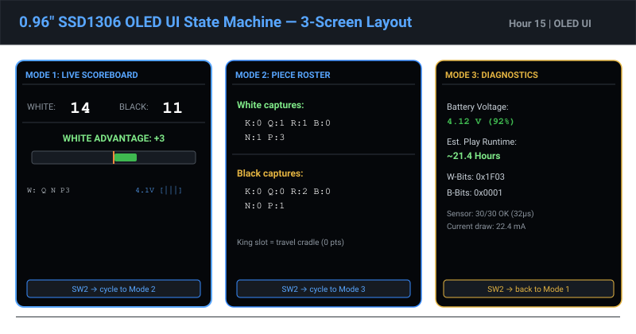

# Chunk 15 — OLED UI Engine & Graphical Material Bar

## Overview & Work Completed
- **Display Engine Architecture:** Built the three-mode graphics rendering engine (`firmware/include/display_ui.h` and `firmware/src/display_ui.cpp`) driving the 0.96" 128×64 SSD1306 OLED over fast 400kHz I2C.
- **Dynamic Material Advantage Bar:** Implemented a real-time 100-pixel visual balance gauge. A centered vertical needle marks parity (0); material leads expand outward to the left (White) or right (Black) at 4 pixels per point, giving instantaneous visual feedback of trade valuations.
- **Multi-View UI System:** Integrated three user-switchable display screens toggled via SW2:
  1. *Live Material Scoreboard:* Numerical tallies, lead badge, and graphical balance bar.
  2. *Captured Piece Roster:* Discrete piece glyph counts (♛, ♜, ♝, ♞, ♟).
  3. *Diagnostics & Power:* Live battery voltage, percentage, and estimated hours remaining.
- **Deliverables Produced:**
  - `firmware/include/display_ui.h`: Screen mode enumerations, frame buffers, and rendering interface.
  - `firmware/src/display_ui.cpp`: Direct SSD1306 rendering routines.
  - `assets/hour15_oled_ui_states.svg`: High-resolution visual mockups of all three OLED display states.

## Work Package Deliverables
- [Display UI Header](../firmware/include/display_ui.h)
- [Display UI Source](../firmware/src/display_ui.cpp)
- [OLED UI State Diagram](../assets/hour15_oled_ui_states.svg)

