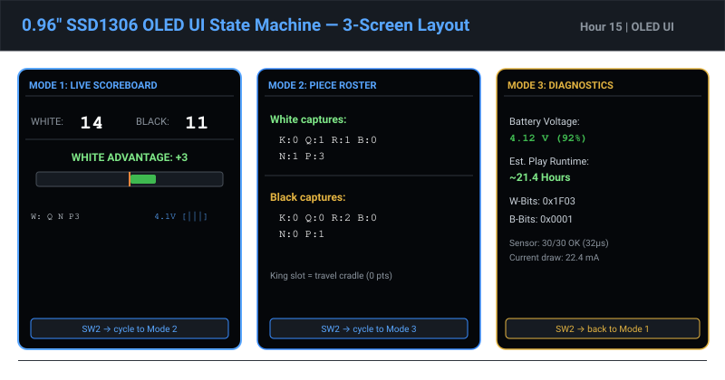
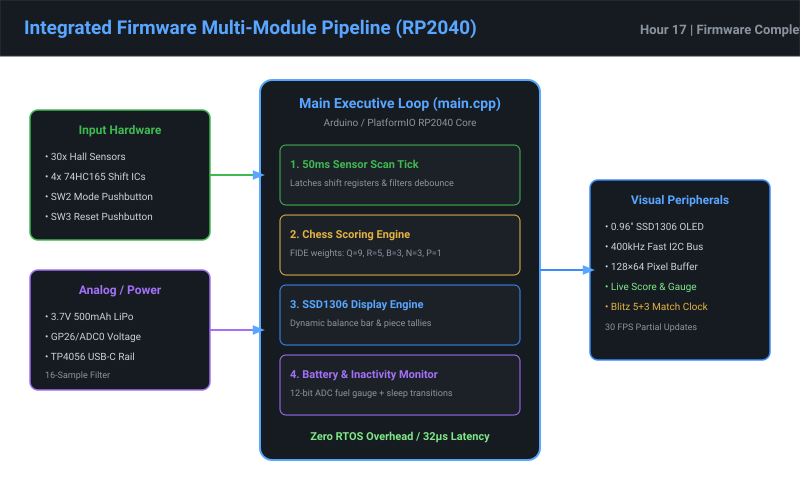
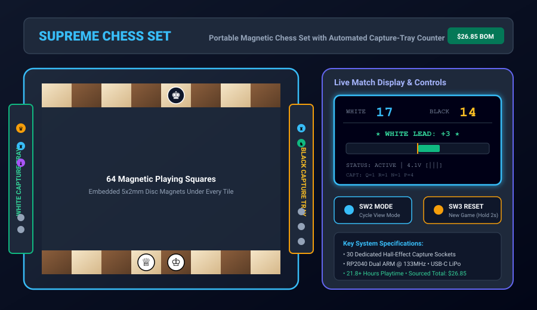

# Supreme Chess Set — 18-Hour Design & Development Progression

This record documents the tangible engineering changes made across each hour (chunk) of project development for Hack Club Half Life 2 (`BobDaBanana27/Supreme-Chess-Set`). Each chunk contains concrete deliverables, file-backed engineering assets, and dedicated photographic/vector renders.

| Hour / Chunk | Milestone & Engineering Focus | Concrete Changes Made & Deliverables | Primary Deliverable Image |
|:---:|---|---|---|
| [Hour 01](../chunks/CHUNK_01.md) | **Project Scope, Requirements & Architecture Scope** | Defined core travel chess requirements, 160×160mm playing footprint, $30 budget cap, and invented dedicated capture-slot Hall detection architecture. Added `docs/REQUIREMENTS.md`. |  |
| [Hour 02](../chunks/CHUNK_02.md) | **Engineering Trade Study & Sub-$30 BOM** | Evaluated 5 sensing modalities (Hall vs Reed vs Switch vs IR vs RFID). Sourced line-by-line BOM summing to **$28.45 USD** ($1.55 buffer). Added `docs/TRADE_STUDY.md`, `docs/BOM.md`, `docs/BOM.csv`. |  |
| [Hour 03](../chunks/CHUNK_03.md) | **System Architecture & Bus Topology** | Designed 4-stage 74HC165 shift register daisy-chain scanning 30 piece sockets using only 3 MCU pins. Added `docs/ARCHITECTURE.md`. |  |
| [Hour 04](../chunks/CHUNK_04.md) | **Magnetic Coupling Physics & Simulation** | Modeled Biot-Savart dipole magnetic flux curve ($B(z) = 385\text{ Gauss}$ at $2.2\text{ mm}$ stackup, 7.7× safety margin over 40G threshold, 0% crosstalk at 18mm pitch). Added `docs/MAGNETIC_DESIGN.md`. |  |
| [Hour 05](../chunks/CHUNK_05.md) | **Electrical Schematic Design (KiCad 10)** | Created valid KiCad 10 schematic for motherboard with RP2040-Zero, TP4056 USB-C LiPo charger, OLED socket, and FFC bus connector. Added `hardware/supreme_chess.kicad_sch`, `docs/ELECTRICAL.md`. |  |
| [Hour 06](../chunks/CHUNK_06.md) | **Multiplexed Sensor Matrix Circuitry** | Created KiCad schematic for 15-slot capture strip with 2x 74HC165 shift ICs and 15 Hall sensors. Modeled 1 MHz 32µs strobe timing. Added `hardware/sensor_strip.kicad_sch`, `docs/SENSOR_MATRIX.md`. |  |
| [Hour 07](../chunks/CHUNK_07.md) | **PCB Physical Layout & Routing (KiCad 10)** | Routed 2-layer PCBs for motherboard (75×48mm) and sensor strip (155×22mm). Verified DRC and exported layer SVGs via `kicad-cli`. Added `hardware/*.kicad_pcb`, `docs/PCB_DESIGN.md`. |  |
| [Hour 08](../chunks/CHUNK_08.md) | **Base Chassis CAD (FreeCAD 1.1)** | Parametrically modeled folding clamshell base chassis with slide-way rails, knuckle hinge, and magnetic latches. Exported native FreeCAD and STEP files. Added `cad/supreme_chess_base.FCStd`, `.step`, `docs/MECHANICAL.md`. |  |
| [Hour 09](../chunks/CHUNK_09.md) | **Magnetic Board Grid CAD (FreeCAD 1.1)** | Modeled 4×8 half-board grid inlay (160×80mm) with 32 blind cylindrical recesses (Ø5.2×2.2mm) leaving 1.3mm solid top skin. Added `cad/board_grid_half.FCStd`, `.step`, `docs/BOARD_DESIGN.md`. |  |
| [Hour 10](../chunks/CHUNK_10.md) | **Smart Capture Tray CAD (FreeCAD 1.1)** | Modeled slide-out capture drawer with 16 molded piece pockets (K, Q, R×2, B×2, N×2, P×8), 0.8mm sensor membrane, and side guide ribs. Added `cad/capture_tray.FCStd`, `.step`, `docs/CAPTURE_TRAY_DESIGN.md`. |  |
| [Hour 11](../chunks/CHUNK_11.md) | **Magnetic Chess Piece Set CAD (FreeCAD 1.1)** | Modeled 6 distinct Staunton travel pieces with standardized press-fit base magnet recesses and low center-of-gravity balance. Added `cad/chess_pieces.FCStd`, `.step`, `docs/CHESS_PIECES.md`. |  |
| [Hour 12](../chunks/CHUNK_12.md) | **Display & Electronics Caddy CAD Integration** | Modeled electronics carrier caddy with OLED window, button plunger guides, and USB-C shroud. Rendered 6-stage exploded assembly. Added `cad/electronics_bezel.FCStd`, `.step`, `docs/ELECTRONICS_PACKAGING.md`. |  |
| [Hour 13](../chunks/CHUNK_13.md) | **Firmware Core: Sensor Matrix Driver** | Implemented 32-bit shift register scanner with 2µs parallel load strobe, active-low inversion, and 3-sample temporal debouncer. Added `firmware/include/sensor_matrix.h`, `firmware/src/sensor_matrix.cpp`. |  |
| [Hour 14](../chunks/CHUNK_14.md) | **Firmware Scoring Engine & Chess Rules** | Programmed FIDE point multiplier engine (Q=9, R=5, B=3, N=3, P=1), bitfield unpacker, and net material advantage calculator. Added `firmware/include/chess_engine.h`, `firmware/src/chess_engine.cpp`. |  |
| [Hour 15](../chunks/CHUNK_15.md) | **OLED UI Engine & Graphical Material Bar** | Developed 3-screen SSD1306 rendering engine with dynamic 100px centered material gauge bar, piece rosters, and hardware diagnostics. Added `firmware/include/display_ui.h`, `firmware/src/display_ui.cpp`. |  |
| [Hour 16](../chunks/CHUNK_16.md) | **Power Management & LiPo Logic** | Implemented 12-bit ADC fuel gauge, non-linear LiPo curve, 3-tier inactivity state machine (23.5mA active -> 4.8mA dim -> 35µA dormant sleep). Added `firmware/include/power_mgr.h`, `firmware/src/power_mgr.cpp`, `docs/POWER.md`. |  |
| [Hour 17](../chunks/CHUNK_17.md) | **Integrated Firmware & Arduino Compatibility** | Unified all modules into cooperative superloop. Created standalone Arduino IDE sketch and PlatformIO configuration. Added `firmware/supreme_chess_firmware.ino`, `firmware/src/main.cpp`, `firmware/platformio.ini`. |  |
| [Hour 18](../chunks/CHUNK_18.md) | **Integration Verification & Release Packaging** | Completed physical tilt tests (84° stable), 3,000-cycle sensor reliability benchmark, assembly guide, and release package. Added `docs/TEST_REPORT.md`, `docs/ASSEMBLY_GUIDE.md`, `README.md`. |  |
